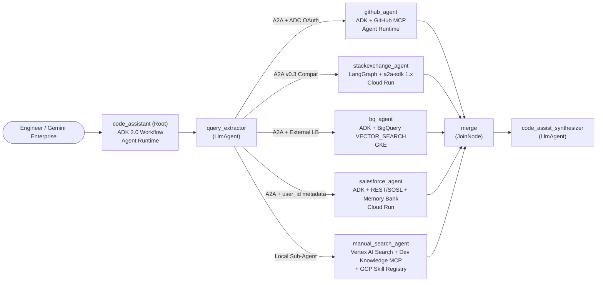

# Build Enterprise Agents (APEX012) — Code Assist Multi-Agent System Runbook

This repository contains the complete consolidated runbook, architectural patterns, reusable code snippets, CLI commands, and reference implementations for the **Build Enterprise Agents (Lab 1 / APEX012)** lab on Google Cloud: building and operating **Code Assist**, an enterprise heterogeneous multi-agent system (ADK 2.0, A2A, MCP, LangGraph, Cloud Run, GKE, Vertex AI Agent Runtime, Gemini Enterprise, and Vertex AI Memory Bank).

---

## Table of Contents

1. [System Architecture & Specialist Matrix](#1-system-architecture--specialist-matrix)
2. [Core Architectural Patterns (Future Reference)](#2-core-architectural-patterns-future-reference)
   - [A2A Interoperability Matrix](#21-a2a-interoperability-matrix)
   - [Cross-Runtime Authentication & Authorization](#22-cross-runtime-authentication--authorization)
3. [Step-by-Step Lab Runbook (Tasks 1–8)](#3-step-by-step-lab-runbook-tasks-18)
   - [Task 1: Environment Setup & Vertex AI Search Datastore](#task-1-environment-setup--vertex-ai-search-datastore)
   - [Task 2: GitHub Agent (ADK + Remote MCP on Agent Runtime)](#task-2-github-agent-adk--remote-mcp-on-agent-runtime)
   - [Task 3: Stack Exchange Agent (LangGraph + a2a-sdk 1.x on Cloud Run)](#task-3-stack-exchange-agent-langgraph--a2a-sdk-1x-on-cloud-run)
   - [Task 4: Bug DB Agent (ADK + BigQuery Vector Search on GKE)](#task-4-bug-db-agent-adk--bigquery-vector-search-on-gke)
   - [Task 5: Root Code Assist Orchestrator (ADK 2.0 Workflow Graph + Skill Registry)](#task-5-root-code-assist-orchestrator-adk-20-workflow-graph--skill-registry)
   - [Task 6: Deploy Root to Agent Runtime, Grant IAM & Publish to Gemini Enterprise](#task-6-deploy-root-to-agent-runtime-grant-iam--publish-to-gemini-enterprise)
   - [Task 7: Extend the System with the Salesforce Agent (2LO OAuth + SOSL on Cloud Run)](#task-7-extend-the-system-with-the-salesforce-agent-2lo-oauth--sosl-on-cloud-run)
   - [Task 8: Long-Term Per-User Memory with Vertex AI Memory Bank](#task-8-long-term-per-user-memory-with-vertex-ai-memory-bank)
4. [Troubleshooting & Operational Gotchas](#4-troubleshooting--operational-gotchas)
5. [Reusable Command & Code Cheat Sheet](#5-reusable-command--code-cheat-sheet)
6. [Repository Structure](#6-repository-structure)

---

## 1. System Architecture & Specialist Matrix



### Specialist Overview

| Agent | Directory | Framework | Runtime Target | Tools / Integration | A2A Mode |
| :--- | :--- | :--- | :--- | :--- | :--- |
| **`github_agent`** | [`agents/github-agent`](./agents/github-agent) | ADK (Python) | Vertex AI Agent Runtime | Hosted GitHub MCP (`https://api.githubcopilot.com/mcp/`) via `McpToolset` | ADK A2A Extension (`use_legacy=False`) |
| **`stackexchange_agent`** | [`agents/stackexchange-agent`](./agents/stackexchange-agent) | LangGraph + `a2a-sdk` 1.x | Cloud Run | Deterministic `StackExchangeTool` (no LLM) | Standard A2A (`0.3` + `1.0` dual card) |
| **`bq_agent`** | [`agents/bq-agent`](./agents/bq-agent) | ADK (Python) | Google Kubernetes Engine (GKE) | `text-embedding-004` + BigQuery `VECTOR_SEARCH` (`COSINE`) | ADK A2A Extension (`use_legacy=False`) |
| **`manual_search_agent`** | Inside [`agents/code-assistant`](./agents/code-assistant) | ADK (Python) | Vertex AI Agent Runtime (in root) | `VertexAiSearchTool` + Developer Knowledge MCP + `GCPSkillRegistry` | In-process Graph Node |
| **`salesforce_agent`** | [`agents/salesforce-agent`](./agents/salesforce-agent) | ADK (Python) | Cloud Run | Salesforce 2LO OAuth + SOSL `ContentVersion` + Vertex AI Memory Bank | ADK A2A Extension (`use_legacy=False`) |
| **`code_assistant` (Root)** | [`agents/code-assistant`](./agents/code-assistant) | ADK 2.0 `Workflow` | Vertex AI Agent Runtime + Gemini Enterprise | `RemoteA2aAgent`, `JoinNode`, `capture_response_to_state` | Root Orchestrator & A2A Server |

---

## 2. Core Architectural Patterns (Future Reference)

### 2.1 A2A Interoperability Matrix

When connecting heterogeneous agents over A2A, keep these protocol details in mind:

| Dimension | Why It Matters | Implementation Pattern |
| :--- | :--- | :--- |
| **Agent Card Path** | Callers discover skills and the JSON-RPC URL from a well-known JSON document. | Custom `a2a-sdk` servers usually mount `/.well-known/agent-card.json`; `agents-cli` scaffolded apps mount `/a2a/app/.well-known/agent-card.json`. |
| **ADK Extension vs. Standard A2A** | ADK-to-ADK calls can transmit richer event metadata when `use_legacy=False`. Non-ADK servers expect standard A2A payloads. | Set `use_legacy=False` on `RemoteA2aAgent` when calling ADK targets (`github_agent`, `bq_agent`, `salesforce_agent`); omit `use_legacy=False` (default `True`) when calling non-ADK servers (`stackexchange_agent`). |
| **`a2a-sdk` 1.x vs. 0.3 Card Compatibility** | ADK's client uses the `a2a-sdk` 0.3 card parser (expects top-level `url`), whereas `a2a-sdk` 1.x moved endpoints into `supported_interfaces`. | In `a2a-sdk` 1.x servers, advertise **both** `protocol_version="1.0"` and `protocol_version="0.3"` in `supported_interfaces`, and pass `enable_v0_3_compat=True` to `create_jsonrpc_routes()`. |
| **Capturing Remote Findings in ADK Workflows** | `RemoteA2aAgent` does not have an `output_key` parameter, so `JoinNode` will not automatically capture its text output into state. | Attach an `after_agent_callback=capture_response_to_state("<key>")` that inspects `callback_context.session.events` in reverse and writes the agent's latest text part into `callback_context.state["<key>"]`. |
| **Forwarding End-User Identity Across A2A** | Unauthenticated A2A requests lack user identity, causing downstream agents to fall back to ephemeral session IDs (`A2A_USER_{context_id}`). | Pass `a2a_request_meta_provider=user_id_meta_provider` on the caller's `RemoteA2aAgent` to inject `{"user_id": ctx.user_id}`, and use a custom `request_converter` on the callee's `A2aAgentExecutorConfig` to set `run_request.user_id`. |

### 2.2 Cross-Runtime Authentication & Authorization

| Target Runtime | Authentication Mechanism | Required IAM Roles on Caller / Workload |
| :--- | :--- | :--- |
| **Vertex AI Agent Runtime** | Always authenticated via Google OAuth2 Bearer token (`google.auth.default()` wrapped in `httpx.Auth`). | Caller (Root Reasoning Engine SA `service-<PROJECT_NUMBER>@gcp-sa-aiplatform-re.iam.gserviceaccount.com`) needs `roles/aiplatform.user` (`aiplatform.reasoningEngines.query`). |
| **Cloud Run (Public)** | `--allow-unauthenticated` (or `allUsers` granted `roles/run.invoker`). | None for public endpoints; for private services, attach an OIDC ID token with `audience=SERVICE_URL` and grant `roles/run.invoker`. |
| **GKE (External LoadBalancer)** | Public Kubernetes `Service` of `type = "LoadBalancer"`. Pod authenticates to GCP APIs via **GKE Workload Identity**. | Bind Kubernetes SA `<project>.svc.id.goog[<ns>/<ksa>]` to GCP SA `<app>-app@<project>.iam.gserviceaccount.com` with `roles/iam.workloadIdentityUser`. Grant the GCP SA `roles/bigquery.jobUser`, `roles/bigquery.dataViewer`, and `roles/aiplatform.user`. |

---

## 3. Step-by-Step Lab Runbook (Tasks 1–8)

### Task 1: Environment Setup & Vertex AI Search Datastore

#### 1. Configure Environment & Install `google-agents-cli`
```bash
export PROJECT_ID="your-gcp-project-id"
export REGION="us-central1"
export PATH="${HOME}/.local/bin:${PATH}"

gcloud config set project "${PROJECT_ID}"
gcloud auth login
gcloud auth application-default login

# Install agents-cli via uv
uv tool install google-agents-cli
agents-cli info
```

#### 2. Provision the Vertex AI Search Datastore (`code-manuals-datastore`)
```bash
# 1. Create the Discovery Engine (Vertex AI Search) datastore
curl -X POST \
  -H "Authorization: Bearer $(gcloud auth print-access-token)" \
  -H "Content-Type: application/json" \
  -H "X-Goog-User-Project: ${PROJECT_ID}" \
  "https://discoveryengine.googleapis.com/v1/projects/${PROJECT_ID}/locations/global/collections/default_collection/dataStores?dataStoreId=code-manuals-datastore" \
  -d '{
    "displayName": "Code manuals",
    "industryVertical": "GENERIC",
    "solutionTypes": ["SOLUTION_TYPE_SEARCH"],
    "contentConfig": "CONTENT_REQUIRED"
  }'

# 2. Import unstructured documents from GCS into branch 0
curl -X POST \
  -H "Authorization: Bearer $(gcloud auth print-access-token)" \
  -H "Content-Type: application/json" \
  "https://discoveryengine.googleapis.com/v1/projects/${PROJECT_ID}/locations/global/collections/default_collection/dataStores/code-manuals-datastore/branches/0/documents:import" \
  -d '{
    "reconciliationMode": "INCREMENTAL",
    "gcsSource": {
      "inputUris": ["gs://'"${PROJECT_ID}"'-bucket/code_manuals/*"],
      "dataSchema": "content"
    }
  }'
```

---

### Task 2: GitHub Agent (ADK + Remote MCP on Agent Runtime)

#### 1. Key Code Implementation (`agents/github-agent/app/agent.py`)
Connect ADK to the remote GitHub Copilot MCP server using `McpToolset` and `StreamableHTTPConnectionParams`, filtering tools to read-only operations:

```python
from google.adk.tools.mcp_tool import McpToolset, StreamableHTTPConnectionParams

GITHUB_TOKEN = os.environ["GITHUB_PERSONAL_ACCESS_TOKEN"]
GITHUB_MCP_URL = os.getenv("GITHUB_MCP_URL", "https://api.githubcopilot.com/mcp/")
GITHUB_TOOL_FILTER = ["search_repositories", "search_issues", "list_issues"]

github_mcp_toolset = McpToolset(
    connection_params=StreamableHTTPConnectionParams(
        url=GITHUB_MCP_URL,
        headers={"Authorization": f"Bearer {GITHUB_TOKEN}"},
    ),
    tool_filter=GITHUB_TOOL_FILTER,
)
```

#### 2. Configure `.env`, Deploy to Agent Runtime & Verify
```bash
cd ~/agents/github-agent
cat << EOF > .env
GOOGLE_CLOUD_PROJECT=${PROJECT_ID}
GOOGLE_CLOUD_LOCATION=global
GOOGLE_GENAI_USE_VERTEXAI=True
MODEL=gemini-3.5-flash
GITHUB_PERSONAL_ACCESS_TOKEN=ghp_YOUR_GITHUB_PAT
GITHUB_MCP_URL=https://api.githubcopilot.com/mcp/
EOF

# Deploy to Vertex AI Agent Runtime
agents-cli deploy --project "${PROJECT_ID}" --no-confirm-project --no-wait \
  --update-env-vars "$(grep -v '^#' .env | grep -v '^$' | grep -v '^GOOGLE_CLOUD_PROJECT' | paste -sd,)"

# Poll deployment status until complete
agents-cli deploy --status

# Export and persist the Agent Card URL
export GITHUB_AGENT_URL="https://us-central1-aiplatform.googleapis.com/reasoningEngines/v1/projects/<PROJECT_NUMBER>/locations/us-central1/reasoningEngines/<ENGINE_ID>/api/a2a/app/.well-known/agent-card.json"
echo "export GITHUB_AGENT_URL='${GITHUB_AGENT_URL}'" >> ~/.bashrc

# Verify the A2A card with an OAuth Bearer token
curl -sS -H "Authorization: Bearer $(gcloud auth print-access-token)" "${GITHUB_AGENT_URL}" | python3 -m json.tool

# Test the deployed Reasoning Engine
export GITHUB_ENGINE_URL=$(echo "${GITHUB_AGENT_URL}" | sed -E 's#/reasoningEngines/v1/#/v1/#; s#/api/.*##')
agents-cli run --url "${GITHUB_ENGINE_URL}" --mode adk "Find the google/adk-python repository"
```

---

### Task 3: Stack Exchange Agent (LangGraph + `a2a-sdk` 1.x on Cloud Run)

#### 1. Key Code Implementation
- **LangGraph StateGraph (`agents/stackexchange-agent/app/agent.py`)**:
```python
graph = (
    StateGraph(State)
    .add_node("search", search)
    .add_edge(START, "search")
    .add_edge("search", END)
    .compile()
)
```
- **Dual-Version `1.0` & `0.3` A2A Server (`agents/stackexchange-agent/app/server.py`)**:
```python
supported_interfaces=[
    AgentInterface(
        url=rpc_url,
        protocol_binding="JSONRPC",
        protocol_version="1.0",
    ),
    AgentInterface(
        url=rpc_url,
        protocol_binding="JSONRPC",
        protocol_version="0.3",
    ),
]
# And in build_app():
jsonrpc_routes = create_jsonrpc_routes(
    request_handler=request_handler,
    rpc_url=RPC_PATH,
    enable_v0_3_compat=True,
)
```

#### 2. Build Container Image & Deploy to Cloud Run
```bash
cd ~/agents/stackexchange-agent

# Build and push container image via Cloud Build
gcloud builds submit --tag "${REGION}-docker.pkg.dev/${PROJECT_ID}/agents/stackexchange-agent:latest"

# Deploy to Cloud Run
gcloud run deploy stackexchange-agent \
  --image "${REGION}-docker.pkg.dev/${PROJECT_ID}/agents/stackexchange-agent:latest" \
  --region "${REGION}" --allow-unauthenticated --port 8080

# Inject PUBLIC_URL so the agent card advertises the external Cloud Run URL
export SE_URL=$(gcloud run services describe stackexchange-agent --region "${REGION}" --format='value(status.url)')
gcloud run services update stackexchange-agent --region "${REGION}" --set-env-vars "PUBLIC_URL=${SE_URL}"

# Export and verify the Agent Card
export STACKEXCHANGE_AGENT_URL="${SE_URL}/.well-known/agent-card.json"
echo "export STACKEXCHANGE_AGENT_URL='${STACKEXCHANGE_AGENT_URL}'" >> ~/.bashrc
curl -sS "${STACKEXCHANGE_AGENT_URL}" | python3 -m json.tool
```

---

### Task 4: Bug DB Agent (ADK + BigQuery Vector Search on GKE)

#### 1. Install `agents-cli` Skills & Terraform
```bash
agents-cli setup --agent all

# Install HashiCorp Terraform (if not installed)
wget -O - https://apt.releases.hashicorp.com/gpg | sudo gpg --dearmor -o /usr/share/keyrings/hashicorp-archive-keyring.gpg
echo "deb [arch=$(dpkg --print-architecture) signed-by=/usr/share/keyrings/hashicorp-archive-keyring.gpg] https://apt.releases.hashicorp.com $(grep -oP '(?<=UBUNTU_CODENAME=).*' /etc/os-release || lsb_release -cs) main" | sudo tee /etc/apt/sources.list.d/hashicorp.list
sudo apt update && sudo apt install -y terraform
```

#### 2. Key Code Implementation (`agents/bq-agent/app/tools.py`)
Embeds the query with `text-embedding-004` (768 dimensions, colocated in `us-central1`) and executes BigQuery `VECTOR_SEARCH` over `code_assist_bugs.known_bugs`:

```python
def find_similar_bugs(query: str) -> str:
    if not query or not query.strip():
        return "No similar bugs found."

    project_id = os.getenv("GOOGLE_CLOUD_PROJECT")
    embedding_location = os.getenv("EMBEDDING_LOCATION", "us-central1")

    genai_client = genai.Client(
        vertexai=True,
        project=project_id,
        location=embedding_location,
    )
    embed_response = genai_client.models.embed_content(
        model="text-embedding-004",
        contents=query,
    )
    embedding_values = list(embed_response.embeddings[0].values)

    bq_client = bigquery.Client(project=project_id)
    resolved_project = project_id or bq_client.project
    table_ref = f"`{resolved_project}.code_assist_bugs.known_bugs`"

    sql = f"""
    SELECT
      base.bug_id AS bug_id,
      base.title AS title,
      base.description AS description,
      base.resolution AS resolution,
      distance
    FROM VECTOR_SEARCH(
      TABLE {table_ref},
      'description_embedding',
      (SELECT @query_embedding AS embedding),
      query_column_to_search => 'embedding',
      distance_type => 'COSINE',
      top_k => 3
    )
    ORDER BY distance ASC
    """
    job_config = bigquery.QueryJobConfig(
        query_parameters=[
            bigquery.ArrayQueryParameter("query_embedding", "FLOAT64", embedding_values)
        ]
    )
    rows = list(bq_client.query(sql, job_config=job_config).result())
    # Format and return bug_id, title, description, resolution, and cosine distance...
```

#### 3. GKE Terraform & IAM Configuration (`agents/bq-agent/deployment/terraform/single-project/`)
- Ensure `app_sa_roles` in `variables.tf` includes:
  - `roles/bigquery.jobUser`
  - `roles/bigquery.dataViewer`
  - `roles/aiplatform.user`
- Ensure `kubernetes_service_v1.app` in `service.tf` uses `type = "LoadBalancer"` (external IP).
- Ensure **Workload Identity** is bound between the Kubernetes SA (`bq-agent/bq-agent`) and the GCP SA (`bq-agent-app@${PROJECT_ID}.iam.gserviceaccount.com`):
```hcl
resource "google_service_account_iam_member" "workload_identity_binding" {
  service_account_id = google_service_account.app_sa.name
  role               = "roles/iam.workloadIdentityUser"
  member             = "serviceAccount:${var.project_id}.svc.id.goog[${var.project_name}/${var.project_name}]"
  depends_on         = [google_container_cluster.app]
}
```

#### 4. Deploy to GKE & Test over A2A
```bash
cd ~/agents/bq-agent
agents-cli deploy --project "${PROJECT_ID}" --no-confirm-project

# Record external LoadBalancer IP and Agent Card URL
export BQ_AGENT_URL="http://<EXTERNAL_LB_IP>:8080/a2a/app/.well-known/agent-card.json"
echo "export BQ_AGENT_URL='${BQ_AGENT_URL}'" >> ~/.bashrc
curl -sS "${BQ_AGENT_URL}" | python3 -m json.tool

# Test via A2A
BQ_BASE_URL=$(echo "${BQ_AGENT_URL}" | sed -E 's#(://[^/]+).*#\1#')
agents-cli run --url "${BQ_BASE_URL}" --mode a2a "Have we seen a memory leak in a background worker before?"
```

---

### Task 5: Root Code Assist Orchestrator (ADK 2.0 Workflow Graph + Skill Registry)

#### 1. Save Remote Agent Replies to Session State (`agents/code-assistant/app/callbacks.py`)
```python
def capture_response_to_state(state_key: str) -> Callable:
    async def _after_agent_callback(callback_context: CallbackContext):
        name = callback_context.agent_name
        for event in reversed(callback_context.session.events):
            if event.author == name and event.content and event.content.parts:
                text = "".join(p.text for p in event.content.parts if p.text)
                if text:
                    callback_context.state[state_key] = text
                    break
        return None

    return _after_agent_callback
```

#### 2. Authenticate Outgoing A2A Calls with ADC (`agents/code-assistant/app/auth.py`)
```python
class GoogleADCAuth(httpx.Auth):
    def __init__(self, scopes=("https://www.googleapis.com/auth/cloud-platform",)) -> None:
        self._creds, _ = google.auth.default(scopes=list(scopes))
        self._req = Request()

    def _apply(self, request: httpx.Request) -> None:
        self._creds.before_request(
            self._req, request.method, str(request.url), request.headers
        )
```

#### 3. Wire Remote Specialists & Parallel Fan-Out/Fan-In Graph (`agents/code-assistant/app/agent.py`)
```python
github_agent = RemoteA2aAgent(
    name="github_agent",
    description="Searches GitHub repositories, issues, and pull requests.",
    agent_card=GITHUB_AGENT_URL,
    httpx_client=google_authed_client(),
    use_legacy=False,
    after_agent_callback=capture_response_to_state("github_findings"),
)

stackexchange_agent = CleanQueryRemoteA2aAgent(
    name="stackexchange_agent",
    description="Searches Stack Exchange for programming questions and errors.",
    agent_card=STACKEXCHANGE_AGENT_URL,
    after_agent_callback=capture_response_to_state("stackexchange_findings"),
)

root_agent = Workflow(
    name="code_assist_agent",
    description=(
        "Researches an error across GitHub, Stack Exchange, Salesforce, and a bug "
        "database (all over A2A) plus code manuals in parallel, then blends a "
        "cited answer."
    ),
    edges=[
        (
            "START",
            query_extractor,
            (
                github_agent,
                stackexchange_agent,
                salesforce_agent,
                bug_db_agent,
                manual_search_agent,
            ),
            merge,
            synthesizer,
        ),
    ],
)
```

#### 4. Publish the Developer Knowledge Skill to GCP Skill Registry
```bash
cd ~/agents/code-assistant
uv run python scripts/publish_skill.py \
  --project "${PROJECT_ID}" \
  --location us-central1
```

---

### Task 6: Deploy Root to Agent Runtime, Grant IAM & Publish to Gemini Enterprise

#### 1. Deploy `code-assistant` to Agent Runtime
> **Important:** Always remove `.venv` before packaging for Agent Runtime if `.venv` is not in `.gitignore`/`.dockerignore`, as symlinks pointing outside the project root are rejected by the Agent Runtime archive bundler.

```bash
cd ~/agents/code-assistant
rm -rf .venv
agents-cli deploy --project "${PROJECT_ID}" --no-confirm-project --no-wait \
  --update-env-vars "$(grep -v '^#' .env | grep -v '^$' | grep -v '^GOOGLE_CLOUD_PROJECT' | paste -sd,)"

agents-cli deploy --status
```

#### 2. Grant IAM Roles to the Reasoning Engine Service Agent
When deployed on Agent Runtime, `code-assistant` executes as `service-<PROJECT_NUMBER>@gcp-sa-aiplatform-re.iam.gserviceaccount.com`. Grant it permission to invoke the `github-agent` Reasoning Engine, load skills from Skill Registry, and query Vertex AI Search:

```bash
gcloud beta services identity create --service=aiplatform.googleapis.com --project="${PROJECT_ID}"

export PROJECT_NUMBER=$(gcloud projects describe "${PROJECT_ID}" --format='value(projectNumber)')

gcloud projects add-iam-policy-binding "${PROJECT_ID}" \
  --member="serviceAccount:service-${PROJECT_NUMBER}@gcp-sa-aiplatform-re.iam.gserviceaccount.com" \
  --role="roles/aiplatform.user"

gcloud projects add-iam-policy-binding "${PROJECT_ID}" \
  --member="serviceAccount:service-${PROJECT_NUMBER}@gcp-sa-aiplatform-re.iam.gserviceaccount.com" \
  --role="roles/discoveryengine.viewer"
```

#### 3. Register in Gemini Enterprise
After creating the `enterprise-app` app (Location: `global`) in the Google Cloud Console UI under **Gemini Enterprise**:

```bash
cd ~/agents/code-assistant
agents-cli publish gemini-enterprise \
  --gemini-enterprise-app-id "projects/${PROJECT_NUMBER}/locations/global/collections/default_collection/engines/enterprise-app" \
  --display-name "Code Assist" \
  --description "Researches a production error across a bug database, the engineering handbook, Salesforce, GitHub, and Stack Exchange, and returns one cited fix."
```

---

### Task 7: Extend the System with the Salesforce Agent (2LO OAuth + SOSL on Cloud Run)

#### 1. Key Code Implementation (`agents/salesforce-agent/app/salesforce_client.py`)
Implement the 2-legged OAuth (`client_credentials`) flow against Salesforce's `/services/oauth2/token` endpoint:

```python
def authenticate(self) -> dict:
    resp = requests.post(
        f"https://{self.domain}/services/oauth2/token",
        data={
            "grant_type": "client_credentials",
            "client_id": self.client_id,
            "client_secret": self.client_secret,
        },
        timeout=_TIMEOUT_SECONDS,
    )
    _raise_for_status(resp)
    return resp.json()
```

#### 2. Deploy `salesforce-agent` to Cloud Run & Rewire Root
```bash
cd ~/agents/salesforce-agent
agents-cli deploy --project "${PROJECT_ID}" --region "${REGION}" --no-confirm-project \
  --update-env-vars "$(grep -v '^#' .env | grep -v '^$' | grep -v '^GOOGLE_CLOUD_PROJECT' | paste -sd,)"

# Allow unauthenticated A2A calls from the root orchestrator
gcloud run services add-iam-policy-binding salesforce-agent \
  --region="${REGION}" --member=allUsers --role=roles/run.invoker

export SF_URL=$(gcloud run services describe salesforce-agent --region "${REGION}" --format='value(status.url)')
export SALESFORCE_AGENT_URL="${SF_URL}/a2a/app/.well-known/agent-card.json"
echo "export SALESFORCE_AGENT_URL='${SALESFORCE_AGENT_URL}'" >> ~/.bashrc
```

---

### Task 8: Long-Term Per-User Memory with Vertex AI Memory Bank

#### 1. Key Code Implementations
1. **Forward Real User ID from Root (`agents/code-assistant/app/app_utils/a2a.py`)**:
```python
def user_id_meta_provider(ctx: InvocationContext, a2a_message) -> dict[str, str]:
    return {"user_id": ctx.user_id}
```
2. **Scope ADK Run to Forwarded User ID (`agents/salesforce-agent/app/app_utils/a2a.py`)**:
```python
def _user_scoped_request_converter(
    request, part_converter=convert_a2a_part_to_genai_part
):
    run_request = convert_a2a_request_to_agent_run_request(
        request, part_converter=part_converter
    )
    forwarded_user_id = (request.metadata or {}).get("user_id")
    if forwarded_user_id:
        run_request.user_id = forwarded_user_id
    return run_request
```
3. **Read & Persist Memories (`agents/salesforce-agent/app/agent.py`)**:
```python
async def generate_memories_callback(callback_context: CallbackContext) -> None:
    await callback_context.add_session_to_memory()

root_agent = Agent(
    name="salesforce_agent",
    model=Gemini(model=MODEL, retry_options=types.HttpRetryOptions(attempts=3)),
    # ...
    tools=[search_salesforce, PreloadMemoryTool()],
    after_agent_callback=generate_memories_callback,
)
```
4. **Idempotent Memory Bank Provisioning (`agents/salesforce-agent/scripts/create_memory_bank.py`)**:
```python
client = vertexai.Client(project=PROJECT, location=LOCATION)
for engine in client.agent_engines.list():
    if engine.api_resource.display_name == DISPLAY_NAME:
        name = engine.api_resource.name
        print(f"Found existing Memory Bank ({DISPLAY_NAME}): {name}")
        print(f"MEMORY_BANK_ID={name.split('/')[-1]}")
        return

engine = client.agent_engines.create(config={"display_name": DISPLAY_NAME})
name = engine.api_resource.name
print(f"Created Memory Bank ({DISPLAY_NAME}): {name}")
print(f"MEMORY_BANK_ID={name.split('/')[-1]}")
```

#### 2. Provision Memory Bank & Redeploy
```bash
cd ~/agents/salesforce-agent
GOOGLE_CLOUD_PROJECT="${PROJECT_ID}" MEMORY_BANK_LOCATION="us-central1" \
  uv run python scripts/create_memory_bank.py

# Append MEMORY_BANK_ID and MEMORY_BANK_LOCATION=us-central1 to salesforce-agent/.env
# Redeploy salesforce-agent and re-apply roles/run.invoker for allUsers
agents-cli deploy --project "${PROJECT_ID}" --region "${REGION}" --no-confirm-project \
  --update-env-vars "$(grep -v '^#' .env | grep -v '^$' | grep -v '^GOOGLE_CLOUD_PROJECT' | paste -sd,)"

gcloud run services add-iam-policy-binding salesforce-agent \
  --region="${REGION}" --member=allUsers --role=roles/run.invoker

# Redeploy root code-assistant so user_id_meta_provider is active in Agent Runtime
cd ~/agents/code-assistant
rm -rf .venv
agents-cli deploy --project "${PROJECT_ID}" --no-confirm-project --no-wait \
  --update-env-vars "$(grep -v '^#' .env | grep -v '^$' | grep -v '^GOOGLE_CLOUD_PROJECT' | paste -sd,)"
```

---

## 4. Troubleshooting & Operational Gotchas

1. **GKE Autopilot Multi-Zone GCE Stockout (`ZONE_RESOURCE_POOL_EXHAUSTED`)**:
   - *Symptom*: Creating a regional GKE Autopilot cluster in `us-central1` can fail if one of the default zones experiences a temporary compute stockout.
   - *Fix*: Switch `google_container_cluster.app` in `service.tf` to a single available zone (`node_locations = ["us-central1-f"]`, `initial_node_count = 1`) with `workload_identity_config` enabled and `workload_metadata_config { mode = "GKE_METADATA" }`.
2. **Cloud Run IAM Reset on `agents-cli deploy`**:
   - *Symptom*: Redeploying `salesforce-agent` via `agents-cli deploy` resets the Cloud Run service IAM policy to authenticated-only.
   - *Fix*: Re-run `gcloud run services add-iam-policy-binding salesforce-agent --region=${REGION} --member=allUsers --role=roles/run.invoker` after each deployment.
3. **Agent Runtime Packaging Fails with `.venv` Symlink Error**:
   - *Symptom*: Running `agents-cli install` or `uv run` locally creates `.venv/bin/python` as a symlink to an external directory, which Agent Runtime's source bundler rejects.
   - *Fix*: Delete `.venv` (`rm -rf .venv`) before `agents-cli deploy`, or add `.venv/` to `.gitignore`.
4. **Vertex AI Memory Bank Location Requirement (`us-central1` vs `global`)**:
   - *Symptom*: Memory Bank returns `404 Not Found` if queried against the `global` endpoint.
   - *Fix*: Always set `MEMORY_BANK_LOCATION=us-central1` even when `GOOGLE_CLOUD_LOCATION=global` is used for `gemini-3.5-flash`.
5. **Application Default Credentials (`service account info is missing 'email' field`)**:
   - *Symptom*: `agents-cli deploy` fails mid-session when temporary Cloud Shell ADC credentials expire.
   - *Fix*: Re-run `gcloud auth application-default login` and `gcloud auth login`.

---

## 5. Reusable Command & Code Cheat Sheet

```bash
# 1. Pass all .env variables (except GOOGLE_CLOUD_PROJECT) into agents-cli deploy:
agents-cli deploy --project "${PROJECT_ID}" --no-confirm-project \
  --update-env-vars "$(grep -v '^#' .env | grep -v '^$' | grep -v '^GOOGLE_CLOUD_PROJECT' | paste -sd,)"

# 2. Check asynchronous Agent Runtime deployment status:
agents-cli deploy --status

# 3. Invoke a deployed Agent Runtime engine from CLI:
agents-cli run --url "https://us-central1-aiplatform.googleapis.com/v1/projects/${PROJECT_NUMBER}/locations/us-central1/reasoningEngines/${ENGINE_ID}" \
  --mode adk "Your prompt here"

# 4. Invoke a deployed native A2A service (Cloud Run or GKE) from CLI:
agents-cli run --url "${BASE_SERVICE_URL}" --mode a2a "Your prompt here"

# 5. Inspect an authenticated Agent Runtime A2A card:
curl -sS -H "Authorization: Bearer $(gcloud auth print-access-token)" "${AGENT_CARD_URL}" | python3 -m json.tool
```

---

## 6. Repository Structure

```text
.
├── README.md                          # Complete consolidated lab runbook & reference guide
└── agents/
    ├── github-agent/                  # Task 2: ADK + GitHub MCP specialist (Agent Runtime)
    ├── stackexchange-agent/           # Task 3: LangGraph + a2a-sdk 1.x specialist (Cloud Run)
    ├── bq-agent/                      # Task 4: ADK + BigQuery VECTOR_SEARCH specialist (GKE + Terraform)
    ├── salesforce-agent/              # Tasks 7 & 8: ADK + Salesforce SOSL + Vertex AI Memory Bank (Cloud Run)
    └── code-assistant/                # Tasks 5 & 6: ADK 2.0 Workflow root orchestrator + Skill Registry
```
